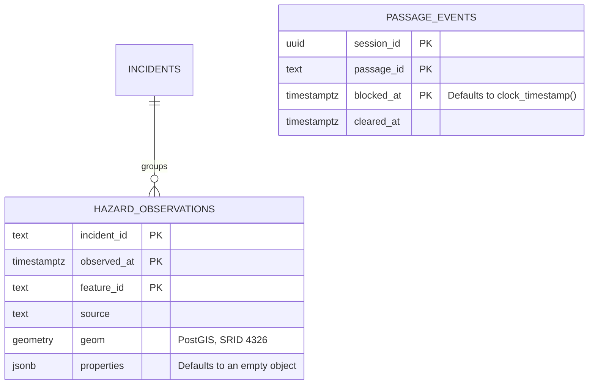

# Tiger Data database for SafeWay

This is a Postgres/PostGIS + TimescaleDB schema for SafeWay's flood-response
exercise. It stores time-series flood observations and route/passage closures.
It deliberately does **not** add a Los Angeles wildfire dataset or wildfire
model: the current application covers Rasuwa and Houston flood scenarios.

## Data model



`blocked_at` is part of the `passage_events` primary key. A time column must be
included in a TimescaleDB hypertable's unique/primary key, and it lets one
passage be closed, cleared, and closed again during the same session.

## Local setup

1. Copy `.env.database.example` to `.env.database` and choose a local password.
2. Start the database:

   ```powershell
   docker compose --env-file .env.database -f docker-compose.database.yml up -d
   ```

3. Check it:

   ```powershell
   docker compose -f docker-compose.database.yml exec headwater-db psql -U headwater -d headwater -c "SELECT extname FROM pg_extension WHERE extname IN ('postgis', 'timescaledb');"
   ```

4. Connect with the `DATABASE_URL` from `.env.database`. Local access is bound
   to `127.0.0.1:5434`, not exposed to other devices.

The initialization SQL runs only for a new Docker volume. If you edit an init
script after the first start, apply it manually with `psql`; do not erase a
volume containing data just to rerun a migration.

## Tiger Cloud setup

Create a Tiger Cloud Postgres service, copy its SSL connection string into a
local, uncommitted `.env.database`, then run the two SQL files in
`database/init/` in the Tiger console SQL editor (extensions first, schema
second). Tiger Cloud supports `CREATE EXTENSION postgis` and TimescaleDB
hypertables, so the same schema applies. To let the server verify the
connection, copy `DATABASE_URL` into `.env` (or start the server with
`--env-file=.env.database`); the operator-only `GET /api/database` endpoint
reports the connection status without exposing the connection string.

## Useful queries

```sql
-- Latest mapped extent for every observed feature in an incident.
SELECT feature_id, observed_at, source, ST_AsGeoJSON(geom)::json AS geometry, properties
FROM current_hazard_observations
WHERE incident_id = 'houston-harvey-2017';

-- Every currently blocked passage for an active drill session.
SELECT passage_id, blocked_at, reason
FROM active_passage_blocks
WHERE session_id = '00000000-0000-0000-0000-000000000000';
```
